# Atividade 4 - API REST com Spring Boot (PetCare)

Aluno: André Vitor de Sales Dias
RA: 237255  
Disciplina: Desenvolvimento Web Backend (UniFacens)

Sistema de clínicas veterinárias: tutores, animais, veterinários, consultas, atendimentos e vacinas.

## Como rodar

Precisa de Java 17.

```
./mvnw spring-boot:run
```

No Windows: `.\mvnw.cmd spring-boot:run`

API: http://localhost:8080

H2 Console: http://localhost:8080/h2-console  
JDBC URL: `jdbc:h2:mem:petcare`  
User: `sa`  
Senha: vazia

## Endpoints

- `POST/GET /tutores` e `GET /tutores/{id}`
- `POST/GET /animais`, `GET /animais/{id}`, `GET /tutores/{id}/animais`
- `POST/GET /veterinarios` e `GET /veterinarios/{id}`
- `POST/GET /consultas`, `GET /consultas/{id}`, `GET /animais/{id}/consultas`, `GET /veterinarios/{id}/consultas`
- `PUT /consultas/{id}/cancelar`
- `POST /atendimentos`, `GET /atendimentos/{id}`, `GET /animais/{id}/atendimentos`
- `POST /vacinas`, `GET /animais/{id}/vacinas`

Regras na camada de serviço: veterinário não agenda no mesmo horário e só atende espécies cadastradas nele. Erro de regra volta 400 com `{ "errors": ["..."] }`.

## Como eu organizei os pacotes

Pra lembrar o fluxo, nomeei as pastas como um restaurante:

| Pacote | Analogia | Na prática |
|---|---|---|
| `controllers_garcom` | Garçom | Recebe o HTTP e devolve JSON |
| `dtos_comanda` | Comanda | Formato do JSON (entra e sai) |
| `services_cozinha` | Cozinha | Interface `*_cardapio` + Impl com as regras |
| `domains_pratos` | Prato | Entidades JPA |
| `repositories_estoque` | Estoque | Acesso ao banco (`JpaRepository` + `@Query`) |
| `configs_gerente` | Gerente | Exception + `@RestControllerAdvice` |

O cliente não recebe a entidade direto. O garçom trabalha com comanda (DTO). A regra fica na cozinha.

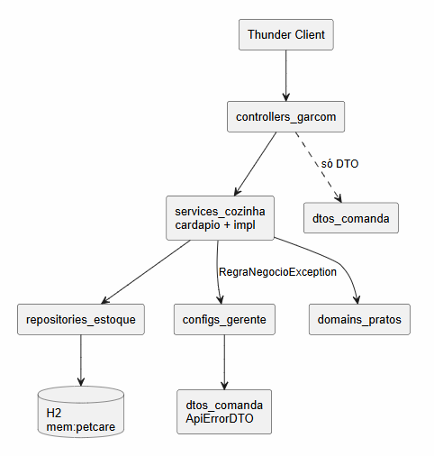

## Diagramas

### Classes UML

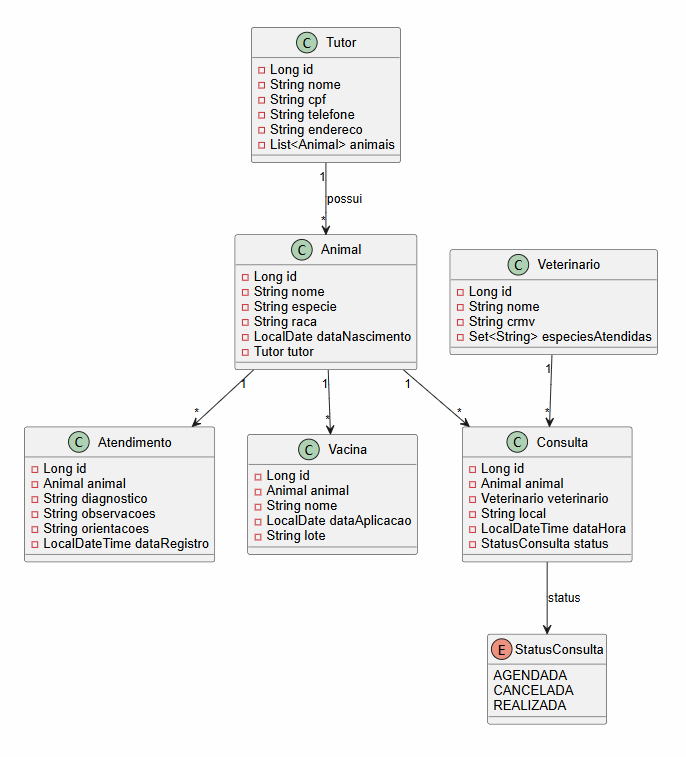

### ER (banco)

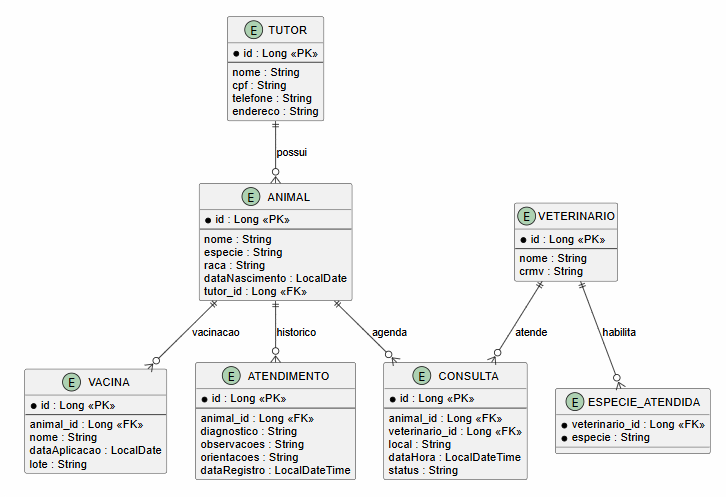

## Exemplos (Thunder Client)

Thunder Client é uma extensão de IDE pra testar API REST (parecido com Postman). Os prints dos testes ficam em `docs/thunder/`.

POST `/tutores`

```json
{
  "nome": "Maria Souza",
  "cpf": "12345678901",
  "telefone": "15999990000",
  "endereco": "Rua A, 10"
}
```

POST `/animais`

```json
{
  "nome": "Thor",
  "especie": "Cachorro",
  "raca": "SRD",
  "dataNascimento": "2020-05-10",
  "tutorId": 1
}
```

POST `/veterinarios`

```json
{
  "nome": "Dr. João",
  "crmv": "SP-12345",
  "especiesAtendidas": ["Cachorro", "Gato"]
}
```

POST `/consultas`

```json
{
  "animalId": 1,
  "veterinarioId": 1,
  "local": "Sala 2",
  "dataHora": "2026-11-05T14:00:00"
}
```

POST `/atendimentos`

```json
{
  "animalId": 1,
  "diagnostico": "Otite",
  "observacoes": "Leve",
  "orientacoes": "Antibiótico 7 dias"
}
```

POST `/vacinas`

```json
{
  "animalId": 1,
  "nome": "V10",
  "dataAplicacao": "2026-11-04",
  "lote": "Lote-001"
}
```

## Testes Thunder Client

Prints em `docs/thunder/`.

### Sucesso

- [x] POST `/tutores` → 201 (Maria Souza, id 1)

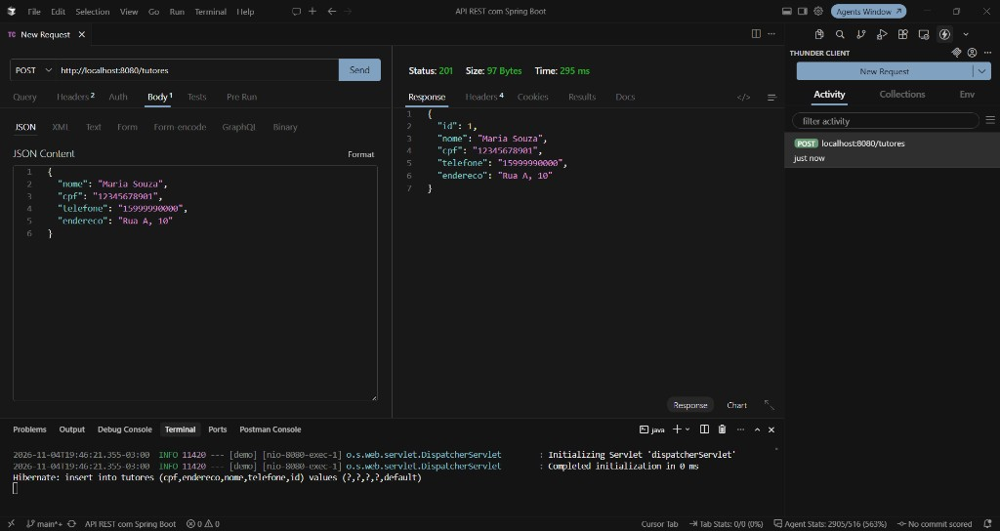

- [x] POST `/animais` → 201 (Thor, id 3)

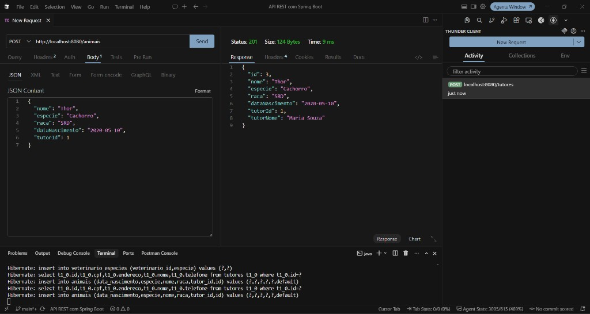

- [x] POST `/veterinarios` → 201 (Dr. João, id 1)

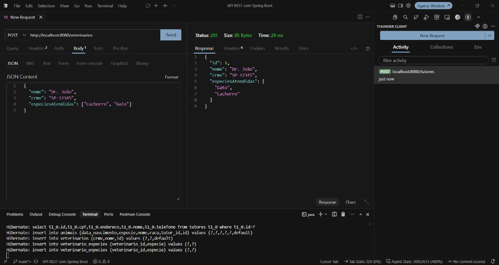

- [x] POST `/consultas` → 201 (id 1, Thor + Dr. João, AGENDADA)

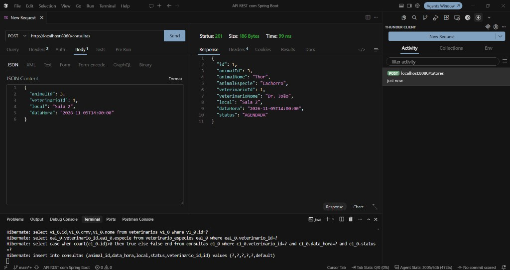

- [x] POST `/atendimentos` → 201 (Otite, Thor id 3)

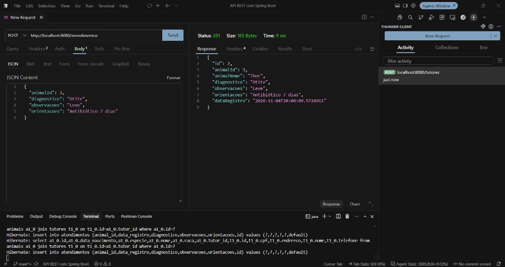

- [x] POST `/vacinas` → 201 (V10, Thor id 3)

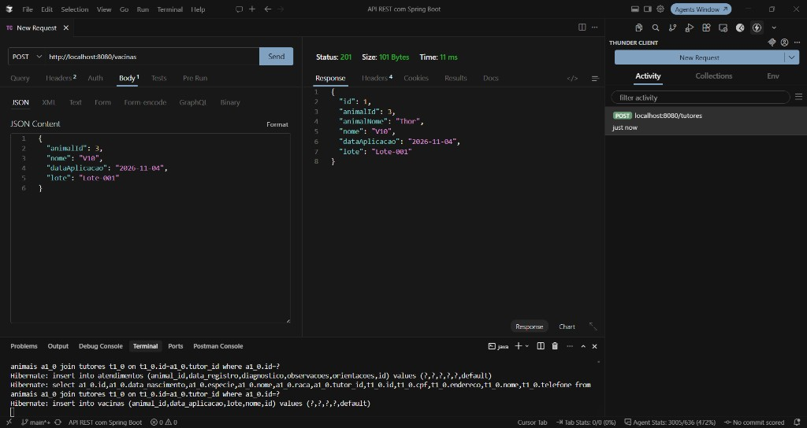

- [x] GET `/animais/3/atendimentos` → 200

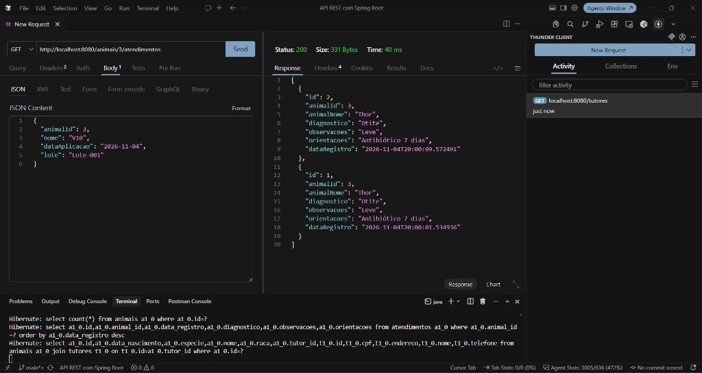

- [x] GET `/animais/3/vacinas` → 200

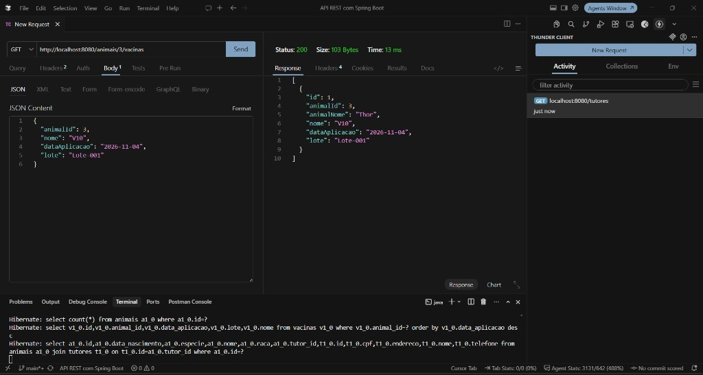

### Erro

- [x] POST consulta no mesmo horário → 400

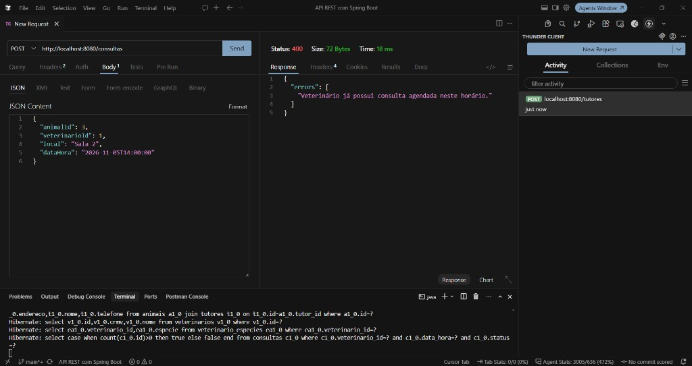

- [x] POST consulta com espécie que o vet não atende → 400

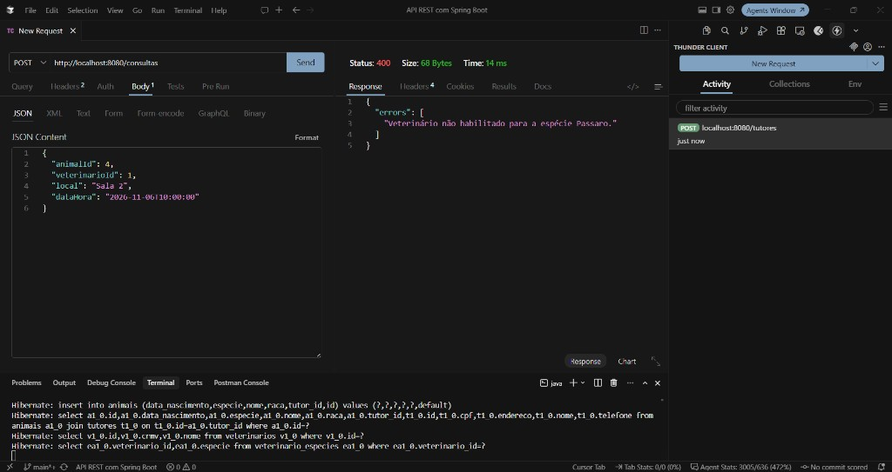

- [x] POST animal com tutor inexistente → 400

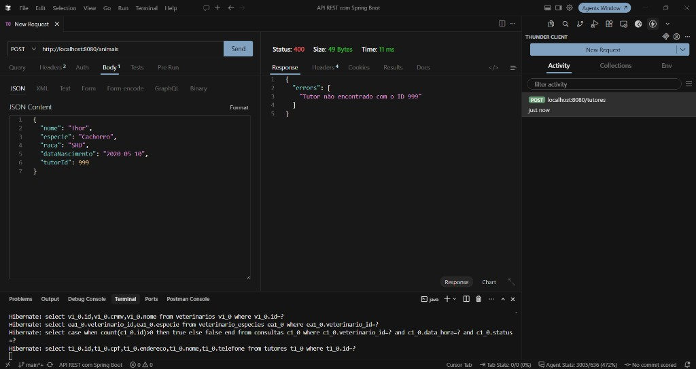

- [x] Cancelar consulta inexistente → 400

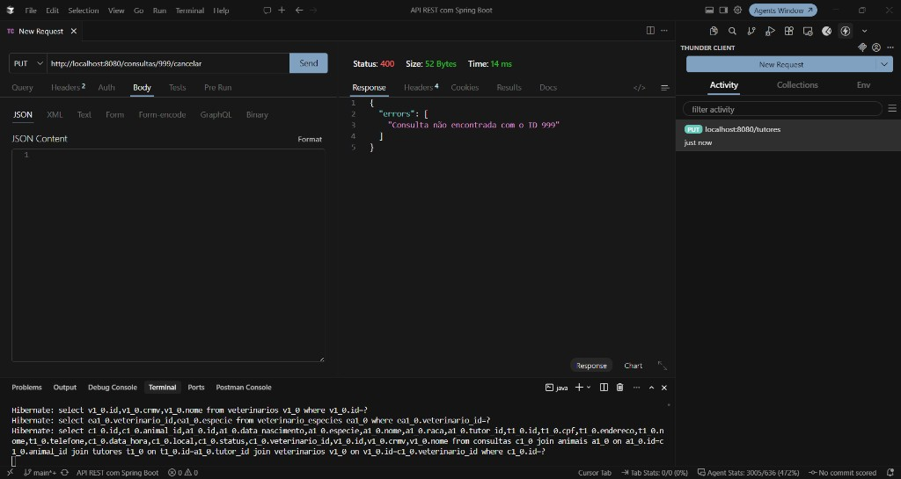

## Observações

- Stack: Java 17, Spring Boot 4.1.2, Spring Data JPA, H2. Sem Lombok.
- Diagramas em `docs/` (`diagrama-classes.png`, `diagrama-er.png`, `diagrama-camadas.png`).
- Prints do Thunder Client em `docs/thunder/`.
